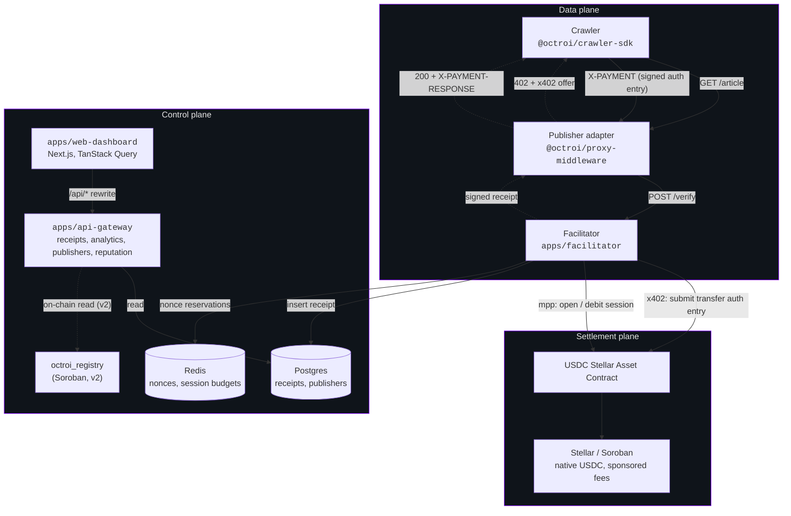
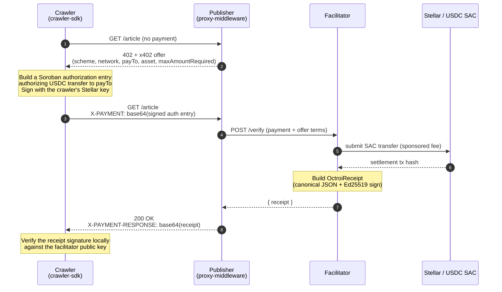

# Octroi

[](./LICENSE)
[](https://stellar.org)
[](https://nodejs.org)
[](https://www.typescriptlang.org)
[](https://pnpm.io)

Octroi lets publishers charge AI crawlers for the pages they fetch. A crawler pays in USDC per URL, in fractions of a cent, and gets back a signed receipt that proves it paid. Humans still browse for free.

Payments settle on Stellar. The default is one signed Soroban authorization per request (the x402 scheme). High-volume crawlers can instead open a session, pre-authorize a budget, and settle in bulk (MPP). USDC is native on Stellar, and the facilitator pays the network fee, so a crawler only needs USDC and never has to hold a gas token.

It is an open, self-hostable alternative to Cloudflare's Pay Per Crawl. Cloudflare only works for sites already behind it, which leaves most of the web without an option. Octroi runs on any stack and anyone can host it. The full spec is in [`docs/PRD.md`](./docs/PRD.md).

> **Status.** This repo is mid-migration from Arc (EVM) to Stellar. The protocol types, the Ed25519 receipt signer, the publisher middleware, the crawler SDK, the facilitator, and the API gateway are built and tested. The part that signs Soroban authorization entries and submits the USDC transfer on-chain is still being written (issues [#1 to #3](https://github.com/vegaforge/octroi/issues)). Code that depends on it throws a clear "not implemented" for now.

## Table of contents

- [Why this exists](#why-this-exists)
- [Why Stellar](#why-stellar)
- [Architecture](#architecture)
- [Protocol flow](#protocol-flow)
- [Settlement models](#settlement-models)
- [Receipt model](#receipt-model)
- [Tech stack](#tech-stack)
- [Repository layout](#repository-layout)
- [Getting started](#getting-started)
- [Documentation](#documentation)
- [Roadmap](#roadmap)
- [Contributing](#contributing)
- [License](#license)
- [References](#references)

## Why this exists

The web's business model assumes humans. People browse a few pages, click an ad now and then, maybe subscribe. AI crawlers don't do any of that. One research bot can pull a million pages a week. At that scale, ads don't work (bots don't see them), subscriptions don't fit (they overcharge a casual reader and undercharge an industrial crawler), and blocking just starts an arms race over IP addresses and user agents. Charging per fetch, as little as $0.0001, is the option nobody could build.

Nobody could build it because the payment rails don't reach that low. Stripe's minimum fee is $0.30, which is 300,000% of a $0.0001 charge. Cloudflare's Pay Per Crawl exists but it is gated to enterprise and only covers sites already on Cloudflare. Everyone else, the small publishers and indie news sites and niche databases, has nothing.

Octroi closes that gap with three things that already work on Stellar:

- **x402 over Soroban authorization entries.** The crawler signs an authorization for a single USDC transfer to the publisher, scoped to a short window and a one-time nonce. One request, one signed authorization.
- **MPP sessions.** For heavy access to one publisher, the crawler pre-authorizes a budget once and streams per-URL debits that settle together. This is a standard protocol, not something Octroi had to invent.
- **Native USDC.** No wrapped token, no bridge. The facilitator covers the network fee, so the crawler funds a USDC budget and that's it.

The wire protocol is x402. A protected URL returns `402 Payment Required` with a JSON offer when there's no payment, and `200 OK` with a receipt header once the crawler pays. Anything that doesn't speak the protocol still sees a normal URL, status code, and body. A crawler that does speak it installs one SDK. And because the request signature follows Web Bot Auth and the payment follows x402, a crawler that already integrated either for Cloudflare or another x402 service can pay Octroi with very little new code.

Every paid fetch returns a signed receipt. Anyone can verify it with the receipt and the facilitator's public key, without touching Octroi's database. The receipt works as an audit log, a billing record, and evidence of paid access if a licensing or copyright question ever comes up.

## Why Stellar

A Stellar account is an Ed25519 keypair, so the crawler's one key is its payment account, its Web Bot Auth signing key, and its reputation identity at the same time. There's no separate identity system to run.

The rest is practical. USDC is native, so there's no bridge in the settlement path. The facilitator sponsors fees, so the crawler holds no gas token. MPP sessions give you batching as a standard primitive instead of a custom service. The base fee is around $0.00001, low enough that even unbatched per-request settlement makes sense for a $0.0001 charge. And publishers can cash out USDC to local currency through Stellar's anchor network, which matters most for the indie and emerging-market creators Octroi is aimed at. [`docs/PRD.md` §4](./docs/PRD.md) covers the reasoning and the tradeoffs in full.

## Architecture

Octroi is split into three planes so that a problem in one doesn't take down the others. The data plane handles the HTTP fetch and the synchronous verify call. The settlement plane moves USDC on Stellar. The control plane serves the dashboard, the API, and (from v2) on-chain reads, and never sits on the hot path.



**Data plane.** There is one enforcement core, and every integration is a thin adapter over it (PRD §7). The middleware classifies the request, returns a 402 offer when payment is due, forwards the crawler's `X-PAYMENT` to the facilitator's `/verify`, and returns the signed receipt. The facilitator does the settlement and the signing, so the adapter stays small and behaves the same everywhere.

**Settlement plane.** The facilitator checks the signed authorization entry against the offer, submits the USDC transfer (and pays the fee), or for a high-volume crawler debits an open MPP session that settles in bulk. USDC goes straight from crawler to publisher. Octroi never holds funds.

**Control plane.** Mostly reads. The api-gateway serves receipts, analytics, publisher onboarding, and a provisional reputation score from Postgres, and gates writes behind a publisher API key (a bearer token). It stays off the hot path, so if it goes down, fetches and settlement keep working. The dashboard is a Next.js app that talks to the gateway through a same-origin `/api/*` rewrite.

## Protocol flow



1. **Discovery.** The crawler reads the price ahead of time from a `/.well-known/octroi` manifest or a robots.txt extension, or it learns the price from the 402 offer on its first request.
2. **Offer.** The middleware classifies the request. If payment is due, it returns a 402 with an x402 offer naming the network, the USDC asset, the payout address, and `maxAmountRequired` in atomic USDC (7 decimals, so `1000` is $0.0001).
3. **Authorization.** The crawler builds a Soroban authorization entry for the USDC transfer, scopes it to a short window and a nonce, signs it with its Stellar key, and sends it base64-encoded in the `X-PAYMENT` header.
4. **Verification.** The facilitator checks the offer terms, reserves the nonce so it can't be replayed, submits the transfer with a sponsored fee, and signs the receipt.
5. **Delivery.** The middleware returns `200` with the receipt in `X-PAYMENT-RESPONSE`. The crawler verifies the signature locally, since it already has the facilitator's public key.

## Settlement models

|          | x402 per-request (default)             | MPP session (high volume)                |
| -------- | -------------------------------------- | ---------------------------------------- |
| Unit     | One signed authorization entry per URL | One pre-authorized budget, many debits   |
| On-chain | One transfer per request               | One bulk settlement per session          |
| Best for | The long tail, with a receipt per URL  | Thousands of fetches an hour, one origin |
| Receipt  | One per URL                            | One per URL (tx backfilled on settle)    |

Both paths produce the same canonical signed receipt, so verification and record-keeping don't care which one was used. The SDK defaults to per-request x402 and switches to an MPP session when it sees sustained high-frequency access to a single publisher.

## Receipt model

Every paid fetch returns a `OctroiReceipt`, signed with the facilitator's Ed25519 (Stellar) key over a canonical JSON form:

```typescript
interface OctroiReceipt {
  version: '1';
  resource: string; // the URL paid for
  amount: string; // atomic USDC (7 decimals), stringified
  asset: string; // 'USDC:GISSUER...'
  network: 'stellar-testnet' | 'stellar-mainnet';
  from: string; // crawler G-address
  to: string; // publisher payout G-address
  nonce: string; // authorization nonce (the replay key)
  timestamp: string; // ISO 8601 UTC
  settlement: 'x402' | 'mpp';
  onchainTxHash: string | null; // transfer hash; null for mpp until bulk settle
  mppSessionRef: { sessionId: string; sequence: number } | null;
  facilitatorPubkey: string; // signer's G-address
  signature: string; // base64 Ed25519 over canonical(body)
}
```

The signature covers a canonical JSON form with sorted keys and stable serialization, so changing any field breaks it. To verify, you recompute the canonical bytes and check the Ed25519 signature against the `facilitatorPubkey` in the receipt. No key recovery, no database lookup, no need to trust Octroi. See [`packages/receipt-signer`](./packages/receipt-signer).

## Tech stack

| Layer          | Tools                                                                 |
| -------------- | --------------------------------------------------------------------- |
| Language       | TypeScript 5.4 strict (facilitator, SDK, dashboard); Go (api-gateway) |
| Runtime        | Node 20+, pnpm 9 workspaces, Turbo; Go 1.25                           |
| Facilitator    | Fastify, `@stellar/stellar-sdk` (Soroban RPC, auth entries)           |
| API gateway    | Go, Gin, pgx; Ed25519 receipt verification matching the TS signer     |
| Frontend       | Next.js 15 (App Router), React 18, Tailwind, TanStack Query           |
| Receipt crypto | Ed25519 over canonical JSON (shared form across TS and Go)            |
| Persistence    | Postgres 16, Redis 7                                                  |
| On-chain (v2)  | `octroi_registry` Soroban contract (Rust, soroban-sdk)                |
| Testing        | Vitest (TS), `go test` (gateway)                                      |

## Repository layout

```
octroi/
├── apps/
│   ├── facilitator/           x402/MPP verification, Soroban settlement, receipt signing
│   ├── api-gateway/           (Go) receipts, analytics, publishers, API-key auth, reputation
│   └── web-dashboard/         landing, onboarding, publisher and crawler dashboards
├── packages/
│   ├── types/                 shared protocol types (offer, receipt, AtomicUsdc)
│   ├── receipt-signer/        canonical-JSON Ed25519 sign and verify
│   ├── proxy-middleware/      drop-in Express middleware for publishers
│   ├── crawler-sdk/           buyer SDK (budgets, retries, cache, payment signing)
│   └── persistence/           Postgres, Redis, and in-memory repos plus migrations
├── contracts/                 Soroban registry and pools (Rust, v2)
├── infra/                     Docker Compose for Postgres and Redis
└── docs/                      the PRD and architecture docs
```

## Getting started

You need Node 20+, pnpm 9, and Docker (for local Postgres and Redis).

```bash
git clone https://github.com/vegaforge/octroi
cd octroi
pnpm install

cp .env.example .env   # fill in the Stellar settings; the file has comments

pnpm typecheck         # tsc --noEmit across the workspace
pnpm test              # Vitest across the packages that have tests
```

Bring up the local services and apply the schema:

```bash
pnpm infra:up          # Postgres and Redis via Docker Compose
pnpm migrate
```

Run the three apps, each in its own terminal:

```bash
pnpm --filter @octroi/facilitator dev   # :3001
pnpm --filter @octroi/api-gateway dev   # :8080
pnpm web:dev                              # :3000
```

[`.env.example`](./.env.example) documents every variable: the Soroban RPC URL, the network, the USDC asset and SAC address, the facilitator signing seed, the fee-sponsor seed, and the database and Redis URLs.

## Documentation

- [`docs/PRD.md`](./docs/PRD.md): the full product requirements doc covering the problem, market, protocol, settlement, identity, security, and roadmap.
- [`.env.example`](./.env.example): the environment-variable reference.
- [`CONTRIBUTING.md`](./CONTRIBUTING.md): how the project is developed, including the one-PR-per-issue workflow.
- [`SECURITY.md`](./SECURITY.md): how to report a vulnerability.

## Roadmap

| Version           | Focus                                                                                                                          | Status      |
| ----------------- | ------------------------------------------------------------------------------------------------------------------------------ | ----------- |
| v0 (testnet)      | protocol, receipt signing, adapters, SDK, facilitator, gateway, dashboard, live Soroban x402 and one MPP path, a 60-fetch demo | in progress |
| v1 (mainnet beta) | WordPress/Ghost/Substack plugins, edge adapters, hosted proxy, discovery manifest, Python SDK, Go gateway, anchor cash-out     | Q3 2026     |
| v2 (reputation)   | `octroi_registry` on-chain identity and reputation, a validator network, a discovery catalog, publisher pools                  | late 2026   |
| v3 (scale)        | CCTP cross-chain payout, subscriptions on MPP, enterprise features (SLA, HSM, SSO), Helm and Kubernetes                        | 2027        |

## Contributing

The workflow is issue-driven: every pull request closes a tracked issue, and a bug gets filed as an issue before it's fixed. Start with [`CONTRIBUTING.md`](./CONTRIBUTING.md) and the [good first issues](https://github.com/vegaforge/octroi/issues?q=is%3Aissue+is%3Aopen+label%3A%22good+first+issue%22).

## License

[Apache License 2.0](./LICENSE).

## References

- [x402](https://x402.org): HTTP-native payment negotiation.
- [Stellar and Soroban](https://developers.stellar.org): smart contracts, the Stellar Asset Contract, and Soroban RPC.
- [USDC on Stellar](https://www.circle.com/usdc): native USDC from Circle.
- [Web Bot Auth](https://datatracker.ietf.org/doc/draft-meunier-web-bot-auth-architecture/): HTTP Message Signatures for crawler identity.
- [Cloudflare Pay Per Crawl](https://blog.cloudflare.com/introducing-pay-per-crawl/): the closed product Octroi is an open alternative to.
