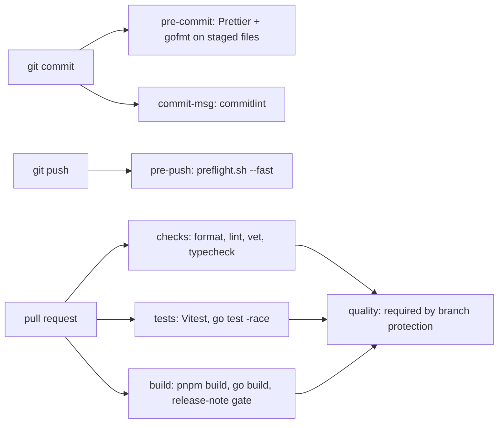

# ADR: AI governance, preflight gates and lefthook

- **Status:** Accepted 2026-10-29
- **Date:** 2026-10-29
- **Scope:** repository tooling and docs only: `AGENTS.md`, `CLAUDE.md`, `.claude/skills/`,
  `scripts/`, `lefthook.yml`, `.github/`, `docs/`, root `package.json`. No application
  code under `apps/` or `packages/` changes.

## Context

Octroi is about to take outside contributions through Drips Wave, and AI coding agents
already work in the repository. On `main` at `6cc1140`:

- There is no written rulebook for agents. `CONTRIBUTING.md` covers people only.
- CI (`.github/workflows/ci.yml`) has two jobs, `verify` (Prettier, typecheck, Vitest)
  and `gateway` (gofmt, `go vet`, `go build`, `go test`). It never runs `pnpm build`,
  so a broken dashboard build can merge. It has no lint step.
- `pnpm lint` exists, but every package's `lint` script is `echo 'noop'` (issue #38).
- Hooks are Husky 9 plus lint-staged: `pre-commit` runs Prettier on staged files and
  `commit-msg` runs commitlint. Nothing runs before a push, and Go files are not
  formatted on commit.
- There is no `.nvmrc`, no release-note convention, and no ADR directory. `main` is not
  protected.
- The PR template is `.github/PULL_REQUEST_TEMPLATE.md`. GitHub accepts either case, but
  on macOS (case-insensitive) a second `pull_request_template.md` next to it collides.

All five gates pass on `main` today: format, `go vet`, typecheck (7 tasks), tests (81
Vitest tests and the Go suite, including `-race`), and the build.

## Decision

1. Add `AGENTS.md` as the single rulebook for every agent, with five directives
   (worktree isolation, ADR pair plus human approval, red-green fixes, no error
   masking, preflight) and the phase 0 to 8 lifecycle. `CLAUDE.md` contains only
   `@AGENTS.md`.
2. Add `.claude/skills/octroi-engineering-standards/SKILL.md` with the real layer map
   (`types` at the bottom, `receipt-signer`, then `proxy-middleware`, `crawler-sdk`
   and `persistence`, then the apps; the Go gateway reaches the rest over HTTP and the
   shared Postgres schema), TypeScript and Go correctness rules, and an 11-item
   payment-path defect checklist.
3. Add `scripts/preflight.sh` with five gates, each covering TypeScript and Go:
   format (`pnpm format:check`, `gofmt -l`), lint (`pnpm lint`, `go vet`), typecheck
   (`pnpm turbo run typecheck`), tests (`pnpm test`, `go test`, with `-race` in CI) and
   build (`pnpm build`, `go build`). `--fast` skips the build.
4. Replace Husky and lint-staged with lefthook 2.2.2 (`lefthook.yml`): `pre-commit`
   runs Prettier and gofmt on staged files with `stage_fixed`, `commit-msg` runs
   commitlint against the existing `commitlint.config.cjs`, `pre-push` runs
   `./scripts/preflight.sh --fast`. The root `prepare` script runs `lefthook install --reset-hooks-path`, which also clears the old husky `core.hooksPath` in existing clones.
5. Replace CI with three parallel jobs (`checks`, `tests`, `build`) and an aggregating
   `quality` job. `build` adds `pnpm build`, which CI never ran, and a strict
   release-note gate. Actions are pinned to commit SHAs and the workflow token is
   `contents: read`.
6. Add `scripts/check_release_notes.sh`: if a pull request changes application code
   (`apps/facilitator` or `apps/web-dashboard` under `src/` or `public/`, Go files in
   the gateway, `packages/*/src` and `packages/*/migrations`, and later
   `contracts/*/src`), it must add a file under `docs/release-notes/`. Manifests and
   lockfiles do not count, so Dependabot pull requests are not blocked.
7. Rename the PR template to `.github/pull_request_template.md` with `git mv` and add
   the governance checklist, adapted to the payment path.
8. Add `.nvmrc` (`20`, matching `engines` and the previous CI), `docs/adr`,
   `docs/plans`, `docs/release-notes`, `docs/scenarios` and `docs/archive` with
   templates, and gitignore `.worktrees/` and root-level `*.sh`.

## Diagram

## Consequences

- CI now fails a pull request whose dashboard build breaks, which it did not before.
- Every pull request that touches application code needs a release note. That is extra
  work for small fixes, and it is the point.
- `git push` takes longer (the fast preflight runs the whole test suite; on a laptop
  it is under a minute).
- Existing clones have `core.hooksPath=.husky/_`. lefthook refuses to install while that
  is set, so `pnpm install` fails with lefthook's message until the contributor runs
  `git config --unset core.hooksPath` once. `CONTRIBUTING.md` says so.
- Gate 2 is only `go vet` in practice until #38 lands; the TypeScript half of the gate
  is wired and turns real when the package scripts do.
- Branch protection must be switched from the old job names (`verify`, `gateway`) to
  `quality`.

## Alternatives considered

- **Keep Husky.** It works for the TypeScript side, but the Go gateway has no Node
  wrapper, and one YAML file is easier to read than a hook directory. lefthook also
  supports `stage_fixed` and per-glob commands without lint-staged.
- **Keep CI as two jobs and add steps.** Simpler, but branch protection would have to
  name every job, and the build would still not have a home.
- **Run `./scripts/preflight.sh` as the only CI step.** One source of truth, but one
  serial job, slower, with worse failure reporting in the GitHub UI.
- **Rely on lefthook's npm `postinstall` instead of `prepare`.** lefthook's docs say
  pnpm needs `onlyBuiltDependencies` for that script to run, and setting it in pnpm 9
  blocks build scripts for every other dependency. An explicit `prepare` works on pnpm
  9 and 10.

## Verification

- `./scripts/preflight.sh` and `./scripts/preflight.sh --fast` pass from the worktree.
- `bash scripts/check_release_notes.sh` passes (no application code changed).
- `pnpm exec lefthook run pre-commit` formats a staged file; `pnpm exec lefthook run
commit-msg <file>` rejects `bad message` and accepts a Conventional Commit.
- `actionlint .github/workflows/ci.yml` reports nothing.
- After merge: the first CI run shows `checks`, `tests`, `build` and `quality`, and the
  maintainer sets `quality` as the required check on `main`.
