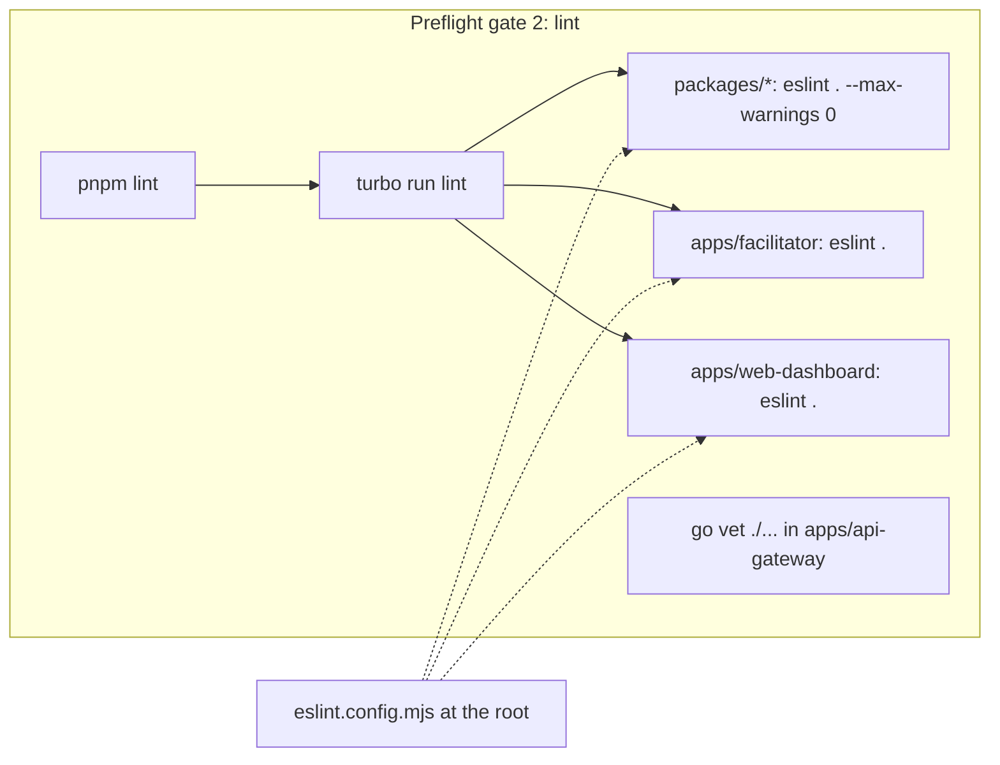

# ADR: ESLint with typed typescript-eslint rules

- **Status:** Accepted 2026-10-29
- **Date:** 2026-10-29
- **Issue:** #38
- **Scope:** root `package.json` and `eslint.config.mjs`, the `lint` script of every
  package and app under `packages/` and `apps/` (TypeScript only), `lefthook.yml` (after
  the governance change), CI `checks` job. Code changes only where a rule finds a real
  defect. The Go gateway keeps `go vet` and is not affected.

## Context

Verified on `origin/main` at `6cc1140`.

- Every package's `lint` script is `echo 'noop'` (`apps/facilitator`,
  `apps/web-dashboard`, and all five `packages/*`). There is no ESLint dependency or
  config in the repo. `CONTRIBUTING.md` says ESLint runs on commit; it does not.
- Turbo already has a `lint` task with no dependencies, and `pnpm lint` runs it.
- TypeScript is 5.9.3 with `strict` and `noUncheckedIndexedAccess`. The dashboard is
  Next 15.5.19.
- The governance preflight (proposed in ADR-2026-10-29-ai-governance) already calls
  `pnpm lint` in gate 2, next to `go vet`, so the gate turns real as soon as the scripts
  do.

### Versions checked on 2026-10-29

| Package              | Latest                                           | Constraint that matters                                 |
| -------------------- | ------------------------------------------------ | ------------------------------------------------------- |
| `eslint`             | 10.13.0                                          | Node `^20.19.0 \|\| ^22.13.0 \|\| >=24`                 |
| `typescript-eslint`  | 8.72.1                                           | peer `eslint ^8.57 \|\| ^9 \|\| ^10`, `typescript <6.1` |
| `@eslint/js`         | 10.0.1                                           | peer `eslint ^10`                                       |
| `eslint-config-next` | 16.4.3 latest; **15.5.19** matches the dashboard | 15.5.19 peers `eslint ^7.23 \|\| ^8 \|\| ^9`, so not 10 |

The dashboard's Next major pins the workspace to ESLint 9 for now.

### Dry run

I installed `eslint@^9.39`, `@eslint/js@^9.39` and `typescript-eslint@^8.72` in a
scratch worktree, ran `recommendedTypeChecked` with `projectService` over
`packages/*/src/**/*.ts` and `apps/facilitator/src/**/*.ts` (62 files), and reverted.
Result: 52 problems in 23 files.

| Count | Rule                             | What it found                                                                                                                |
| ----- | -------------------------------- | ---------------------------------------------------------------------------------------------------------------------------- |
| 35    | `require-await`                  | Fastify handlers declared `async` with no `await` (`routes/health.ts`), and test stubs                                       |
| 4     | `no-unused-vars`                 | an unused `AtomicUsdc` import in `crawler-sdk/src/client.ts`; underscore-prefixed parameters in `budget.ts` and `pricing.ts` |
| 3     | `no-unsafe-assignment`           | `scValToNative` results (`soroban-settlement.ts:210`, `payment-signer.ts:151`)                                               |
| 3     | `no-unsafe-argument`             | the same values passed on                                                                                                    |
| 3     | `no-redundant-type-constituents` | `OctroiErrorCode \| string` unions in `crawler-sdk/src/retry.ts` and `types.ts`                                              |
| 2     | `no-unsafe-return`               | `JSON.parse` returned as `OctroiReceipt` in `proxy-middleware/src/receipts.ts:10` and `crawler-sdk/src/client.ts:368`        |
| 1     | `no-misused-promises`            | `express.ts:27`: an `async` function typed as Express 4 `RequestHandler`, so a rejection inside it is never handled          |
| 1     | `no-unnecessary-type-assertion`  | `types/src/primitives.ts:30`                                                                                                 |

`no-floating-promises` found nothing. The `no-misused-promises` and `no-unsafe-return`
findings are real defects on the payment path: an unhandled rejection in the
middleware, and receipts decoded from a header without validation.

## Decision

1. **Dependencies (root `devDependencies`):** `eslint@^9.39`, `@eslint/js@^9.39`,
   `typescript-eslint@^8.72`, and in `apps/web-dashboard` `eslint-config-next@15.5.19`
   (same version as `next`). Move to ESLint 10 in the same change that moves the
   dashboard to Next 16.
2. **One root `eslint.config.mjs`** using `defineConfig` from `eslint/config`:
   - Global ignores: `**/dist/**`, `**/.next/**`, `**/node_modules/**`,
     `**/next-env.d.ts`, `.worktrees/**`, `apps/api-gateway/**`.
   - `packages/*/src/**/*.ts` and `apps/facilitator/src/**/*.ts`:
     `js.configs.recommended` + `tseslint.configs.recommendedTypeChecked`, with
     `parserOptions.projectService: true` and `tsconfigRootDir: import.meta.dirname`.
   - `apps/web-dashboard/**/*.{ts,tsx}`: the Next core-web-vitals and TypeScript rules
     from `eslint-config-next` 15 (through `FlatCompat` from `@eslint/eslintrc`, the
     path Next 15 documents; Next 16's native flat export replaces it later), plus the
     same typed rules, with `settings.next.rootDir: 'apps/web-dashboard/'`.
   - `**/*.{js,mjs,cjs}`: `tseslint.configs.disableTypeChecked`.
3. **Rules on top of the presets**, each with a one-line reason in the config:
   - `@typescript-eslint/no-floating-promises: error` and
     `@typescript-eslint/no-misused-promises: error` (already in the preset; listed so
     nobody turns them off quietly).
   - `@typescript-eslint/no-explicit-any: error`, `@typescript-eslint/ban-ts-comment`
     with `ts-expect-error` allowed only with a description of at least 10 characters.
   - `@typescript-eslint/no-unused-vars` with `argsIgnorePattern: '^_'` and
     `varsIgnorePattern: '^_'`, matching the existing convention for deliberately unused
     parameters.
   - `@typescript-eslint/consistent-type-imports: error` (the code already uses
     `import type` almost everywhere).
   - In `**/__tests__/**`: `require-await` off (stub methods implement async
     interfaces), `no-unsafe-*` stay on.
   - Everywhere else `require-await` stays on. Fastify handlers without `await` drop the
     `async` keyword and return the value; Fastify accepts both.
4. **Fix the findings, do not suppress them.** In particular:
   - `express.ts`: the middleware becomes a sync `RequestHandler` that calls an inner
     async function and passes any rejection to `next(err)`, so Express 4 sees it.
   - `decodeReceiptHeader` (both copies) and the `scValToNative` call sites parse into
     `unknown` and narrow with a type guard, so a malformed header or ScVal fails with a
     clear error instead of flowing on as `any`.
   - `OctroiErrorCode | string` becomes `OctroiErrorCode`, or a named wider type where
     the SDK genuinely accepts unknown upstream codes.
5. **Scripts.** Each package's `lint` script becomes `eslint . --max-warnings 0`, run
   from the package directory so Turbo caches per package. The root keeps
   `"lint": "turbo run lint"`. ESLint finds the root config by walking up from the
   package directory.
6. **Next build.** Set `eslint.ignoreDuringBuilds: true` in
   `apps/web-dashboard/next.config.ts` so the dashboard is linted once, in gate 2, and
   not again inside `next build` with a different config lookup.
7. **Gate 2 and hooks.** No preflight change: gate 2 already runs `pnpm lint` and
   `go vet`. CI's `checks` job already runs `pnpm lint`. The lefthook pre-commit gets an
   `eslint` command for staged `*.{ts,tsx}` files, `run: pnpm exec eslint --fix
--max-warnings 0 {staged_files}`, `stage_fixed: true`.
8. **Rollout in one pull request**, ordered as separate commits: tooling and config;
   mechanical fixes (`require-await`, unused imports, type imports); behavioural fixes
   (`express.ts`, receipt decoding, ScVal narrowing), each with a test that failed
   before it; CONTRIBUTING and lefthook. The pull request depends on the governance PR
   for lefthook and the preflight; if it lands first, the lefthook step moves to a
   follow-up.

## Diagram

## Consequences

- `pnpm lint` fails on real problems. Gate 2 stops being `go vet` alone.
- Typed linting is slower than untyped: expect several seconds per package on a cold
  run. Turbo caches the result per package, and the pre-commit hook lints only staged
  files.
- ESLint stays on 9 until the dashboard moves to Next 16. That is a known, dated
  constraint, not drift.
- Contributors see red squiggles for `any`, unsafe returns and promise misuse. That is
  the intent; the money path is where these bugs cost the most.

## Alternatives considered

- **`recommended` without type information.** Faster, but loses
  `no-misused-promises`, `no-floating-promises` and the `no-unsafe-*` family, which
  found the two real defects in the dry run.
- **`strictTypeChecked`.** More rules, more churn in one pull request. Can be adopted
  later rule by rule.
- **A config per package.** More files to keep in sync. One root config with `files`
  blocks keeps the rules in one place; per-package `lint` scripts keep Turbo caching.
- **Biome instead of ESLint.** Fast and one tool for format and lint, but no typed rules
  equivalent to `no-misused-promises` today, and Prettier is already in place.
- **Turning off the rules that fire.** Rejected by AGENTS.md Directive 4.

## Verification

- `pnpm lint` passes on the branch with `--max-warnings 0`.
- A deliberately bad file (`const x: any = 1; Promise.resolve();` in a package `src/`)
  makes `pnpm lint` exit non-zero, then is removed.
- `./scripts/preflight.sh` passes.
- `pnpm exec lefthook run pre-commit` with a staged TypeScript file that has a fixable
  problem rewrites it and re-stages it.
- New tests for the `express.ts` rejection path and the receipt decoder fail before
  their fixes and pass after.
