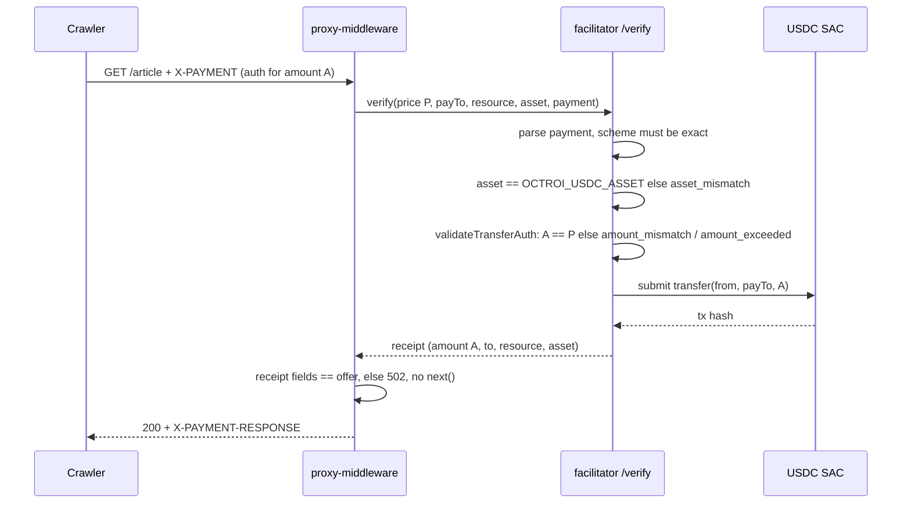

# ADR: Exact-amount settlement and asset binding

- **Status:** Accepted 2026-10-29
- **Date:** 2026-10-29
- **Issue:** #37
- **Scope:** `packages/types` (error codes), `apps/facilitator` (config, `/verify` route,
  `FacilitatorService`, `validateTransferAuth`), `packages/proxy-middleware`
  (`express.ts`). No change to the receipt format, the wire field names, the SQL schema,
  the crawler SDK or the Go gateway.

## Context

Verified by reading `origin/main` at `6cc1140`.

### The underpayment hole

1. The middleware prices a request and sends the price to the facilitator as
   `maxAmountRequired` (`packages/proxy-middleware/src/express.ts`, the
   `facilitator.verify({... maxAmountRequired: pricing.priceAtomic.toString() ...})`
   call).
2. The facilitator route checks only that `maxAmountRequired` is a digit string
   (`apps/facilitator/src/routes/verify.ts`) and passes it through
   `FacilitatorService.verify` to `StellarSorobanSettlement.settle`.
3. `validateTransferAuth` (`apps/facilitator/src/services/soroban-settlement.ts`)
   decodes the signed Soroban authorization entry and rejects the amount only when
   `amount <= 0n` or `amount > ctx.maxAmount`. Any amount from 1 to the price passes.
4. `settle` submits the transfer for the authorized amount and returns it; the receipt
   records that real amount.
5. Back in the middleware, the only check is `result.ok`. It never compares
   `receipt.amount` with the price, then calls `next()` and reports
   `amount: pricing.priceAtomic` to `onPayment`.

So a crawler can authorize 1 base unit (0.0000001 USDC) for a page priced at 1000 and
receive the content, a valid signed receipt for 1 unit, and an `onPayment` event that
tells the publisher it was paid 1000. The SDK in this repo always signs
`BigInt(requirement.maxAmountRequired)` (`payment-signer.ts`), so honest crawlers pay
the full price; only a modified client exploits this.

`PaymentScheme` is `'exact'` and is the only scheme in `@octroi/types`. The 402 offer
always says `scheme: 'exact'`. Under x402's `exact` scheme the amount is the price, not
a ceiling. The facilitator never reads `payment.scheme` at all.

### The asset binding gap

- The facilitator loads `OCTROI_USDC_ASSET` and `OCTROI_USDC_SAC` independently
  (`apps/facilitator/src/config.ts`), and only the SAC is used (`index.ts` passes
  `sacAddress: config.usdcSacAddress`). Nothing checks that the two describe the same
  asset.
- `validateTransferAuth` requires the authorization to invoke the configured SAC, so the
  token that actually moves is always the configured one.
- But the `asset` written into the receipt is the caller-supplied `/verify` field, which
  is only checked against the `CODE:ISSUER` regex. A receipt can therefore name an asset
  that did not move.

### Why it matters

The amount and the asset are the two numbers a receipt exists to prove. Publishers bill
from `onPayment` and from the receipts table; the gateway's analytics and provisional
reputation count those receipts.

Threat framing (attacker: any HTTP client that can reach the publisher, or the
facilitator directly, since `/verify` is unauthenticated):

| Abuse                                                                                    | Today                                                | After this ADR                                       |
| ---------------------------------------------------------------------------------------- | ---------------------------------------------------- | ---------------------------------------------------- |
| Pay 1 unit for a 1000-unit page                                                          | content served, receipt for 1, `onPayment` says 1000 | facilitator 402 `amount_mismatch`, nothing submitted |
| Pay more than the price                                                                  | 402 `amount_exceeded`                                | unchanged                                            |
| Receipt names a different asset than the one moved                                       | possible via direct `/verify`                        | 402 `asset_mismatch`                                 |
| Facilitator misconfigured with mismatched asset and SAC                                  | runs, writes misleading receipts                     | refuses to start                                     |
| Facilitator (bug or compromise) returns a receipt for less, another payee or another URL | middleware serves content                            | middleware refuses with 502 and reports the error    |

Out of scope here and tracked separately: authenticating `/verify` and binding
`publisherId` to `payTo`, reserving the nonce before settlement and scoping it to
`(from, nonce)`, verifying the receipt signature against a pinned facilitator key in
the middleware and the SDK, and the SDK's own asset allowlist.

## Decision

1. **Exact amount in the facilitator.** `validateTransferAuth` takes `requiredAmount`
   (renamed from `maxAmount`) and accepts only `amount === requiredAmount`:
   - `amount > requiredAmount` returns `amount_exceeded` (unchanged code).
   - `0 < amount < requiredAmount` returns a new `amount_mismatch` code.
   - `amount <= 0n` or a non-`bigint` stays `invalid_payload`.

   The wire field keeps its x402 v1 name, `maxAmountRequired`; its meaning for the
   `exact` scheme is "the amount", and the type doc comment says so.

2. **Scheme check at the boundary.** The `/verify` route rejects a `payment` whose
   `scheme` is not `'exact'` or whose shape is not a valid `X402PaymentPayload` or
   `MppPaymentPayload` with `400` before any service call. This replaces the
   `body.payment as unknown as PaymentPayload` cast with a real parser.
3. **Asset binding in the facilitator.** `FacilitatorService` is constructed with the
   configured `usdcAsset`. `verify` rejects `input.asset !== usdcAsset` with a new
   `asset_mismatch` code before calling `settle`, so no fee is sponsored and no receipt
   can name an asset that did not move.
4. **Startup consistency check.** `loadConfig` derives the SAC id from
   `OCTROI_USDC_ASSET` with `new Asset(code, issuer).contractId(passphrase)` (the same
   call `deriveSacContractId` in the crawler SDK makes) and throws unless it equals
   `OCTROI_USDC_SAC`.
5. **Middleware checks the receipt before serving.** After a successful `verify`, the
   Express middleware compares the receipt with what it offered: `amount` equals
   `priceAtomic.toString()`, `to` equals `publisherWallet`, `resource` equals `fullUrl`,
   `asset` equals `config.asset`, `network` equals `config.network`. On any mismatch it
   does not call `next()`, responds `502` with
   `{ x402Version: 1, error: 'facilitator_error' }`, and calls `onError` with phase
   `'verify'` naming the field. `onPayment` reports `atomicUsdc(BigInt(receipt.amount))`.
6. **Error codes.** Add `amount_mismatch` and `asset_mismatch` to `OctroiErrorCode` in
   `packages/types/src/errors.ts` and to the table in `docs/PRD.md` section 9.7.
7. **Red-green order.** The first commit on the branch is the failing test below. The
   fix follows in the same pull request.

## Red test (write first)

In `apps/facilitator/src/__tests__/soroban-settlement.test.ts`, next to
`rejects when the amount exceeds the ceiling`, using the file's existing `makeEntry` and
`ctx` helpers:

```ts
it('rejects an authorization for less than the offered amount', async () => {
  const crawler = Keypair.random();
  const publisher = Keypair.random().publicKey();
  const entry = await makeEntry({
    fromAddr: crawler.publicKey(),
    signWith: crawler,
    to: publisher,
    amount: 1n,
    validUntil: 200,
  });
  const result = validateTransferAuth(
    entry,
    ctx({
      payTo: publisher as StellarAddress,
      declaredFrom: crawler.publicKey() as StellarAddress,
      maxAmount: 1000n,
    }),
  );
  expect(result.ok).toBe(false);
  if (result.ok) return;
  expect(result.error.code).toBe('amount_mismatch');
});
```

Red output on `main`, confirmed by running this exact test on `6cc1140`
(`npx vitest run src/__tests__/soroban-settlement.test.ts -t "less than the offered"`):
`AssertionError: expected true to be false`, on the `result.ok` assertion, because the
1-unit authorization is accepted today. That is the defect, not a typo. `tsc --noEmit`
passes with the test in place, because `toBe` does not constrain the expected literal. Once Decision 1 renames the context field, the test uses
`requiredAmount: 1000n`.

The same pull request then adds, all failing before the fix:

- `soroban-settlement.test.ts`: `StellarSorobanSettlement.settle` with a 1-unit entry
  returns `amount_mismatch` and the stub gateway's `submitTransfer` is never called.
- `facilitator-service.test.ts`: `verify` with `asset` different from the configured
  asset returns `asset_mismatch` and the settlement stub is never called.
- A new `apps/facilitator/src/__tests__/verify-route.test.ts` using
  `buildServer(...).inject()`: a payment with `scheme: 'upto'` returns 400; an
  underpayment returns 402 with `error.code === 'amount_mismatch'`.
- A new `apps/facilitator/src/__tests__/config.test.ts`: `loadConfig` throws when
  `OCTROI_USDC_SAC` is not the SAC of `OCTROI_USDC_ASSET`.
- A new `packages/proxy-middleware/src/__tests__/express.test.ts` (there are no
  middleware handler tests today). It mounts the middleware on an Express app on an
  ephemeral port and drives it with Node's `fetch`, with a mock `FacilitatorClient`.
  Cases: receipt `amount` `'1'` for a `1000` price gives 502, the route handler is not
  reached and `onPayment` is not called; wrong `to`, wrong `resource` and wrong `asset`
  each give 502; a matching receipt reaches the handler and `onPayment` gets
  `amount === 1000n`.

## Diagram



## Consequences

- A crawler that pays less than the price gets a 402 with `amount_mismatch` and no
  content. No honest client in this repo is affected, because the SDK already signs the
  full price.
- Two new public error codes. Third-party clients that switch on error codes see a new
  value; the PRD table documents it.
- A misconfigured facilitator (asset and SAC from different issuers or networks) now
  fails at startup instead of serving. Operators see the error in the log.
- The middleware does more work per paid request (five string comparisons). The 502 path
  only fires if the facilitator is buggy or hostile, and in that case money may already
  have moved; the error event gives the publisher what they need to investigate.
- `maxAmountRequired` keeps a misleading name on the wire. Renaming it belongs to the
  x402 v2 alignment decision, not here.

## Alternatives considered

- **Check only in the middleware.** Stops content delivery, but the facilitator would
  still settle the underpayment, sponsor its fee and write a receipt that the gateway
  counts. Rejected: the facilitator is the component that must not settle a wrong
  transfer.
- **Check only in the facilitator.** Fixes the hole, but the middleware would keep
  trusting whatever comes back from a URL in its config. Rejected: defence in depth is
  cheap here.
- **Reuse `amount_exceeded` for underpayment.** Fewer codes, but the client's correct
  reaction differs (rebuild with the offered amount in both cases, but the message would
  be wrong). The issue asks for a distinct code.
- **Compare `asset` by deriving the SAC per request.** Equivalent once Decision 4 holds
  at startup, and costs a hash per request. String equality against the configured asset
  is simpler.

## Verification

- The red test fails on `main` with `expected true to be false`, then passes.
- `pnpm --filter @octroi/facilitator test` and `pnpm --filter @octroi/proxy-middleware
test` pass with the new cases.
- `./scripts/preflight.sh` passes.
- Manual, on Stellar testnet: run the facilitator and the demo middleware, send a
  hand-built `X-PAYMENT` for 1 unit against a 1000-unit price, and confirm a 402 with
  `amount_mismatch` and no transaction for that nonce on stellar.expert. Repeat with the
  SDK and confirm a 200 and a receipt for 1000.
- Start the facilitator with `OCTROI_USDC_SAC` set to another contract and confirm it
  exits with the mismatch error.
